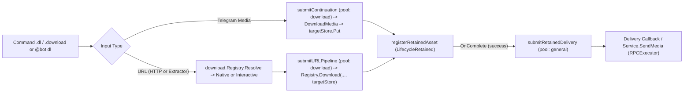
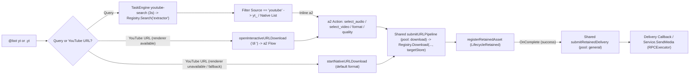

# DL-B — Downloader Domain Separation Design

## Status

- Status: **DL-B Complete (Design & Documentation Only — Approved for DL-C)**
- Workstream: P1 (Downloader + YouTube Domain Separation) of `docs/design/goultroid-existing-plugin-enhancement-roadmap.md`
- Branch: `test-next`
- Baseline HEAD: `abbd472a09f7fac086cf0eb50466e833ced481db`
- Scope: target architecture, package/API/state ownership, `.yt` semantics, sequential storage-to-delivery flow, expanded test matrix, and rollback strategy. No production code was modified.

---

## 1. Target Architecture & Domain Boundary

**Core Principle:** Never equate the **YouTube feature** with `ExtractorProvider`. `ExtractorProvider` supports 14 social/video domains and remains shared extraction infrastructure used by **both** General Downloader and YouTube.

### 1.1 Layering

1. **General Downloader Domain (`plugins/downloader` — generic workflow):**
   - Owns `.download` / `.dl` command routing, Telegram replied/attached media download (`executeMediaDownload`), generic direct HTTP URL download, and generic extractor URL download (TikTok, Instagram, X/Twitter, Reddit, Facebook, Vimeo, SoundCloud, Twitch, etc.).
   - Owns generic URL validation, generic metadata/caption formatting, and non-YouTube interactive format probing.
   - Does **not** own YouTube search, YouTube search result selection, or YouTube-specific metadata/UX.
2. **YouTube Feature Domain (`plugins/downloader` — isolated YouTube feature unit):**
   - Owns `@bot yt <query>` inline search and `.yt <query-or-url>` native command (`DL-D`), YouTube search result selection (`yt_<SourceID>`), YouTube metadata presentation (title, duration, channel), and YouTube-specific audio/video/quality UX.
   - Calls the **shared** `download.Registry` (`Search("extractor", ...)`, `Probe`, `Download`) and **shared** `submitURLPipeline` → `submitRetainedDelivery` — never duplicating `yt-dlp`, `TaskEngine`, `mediaregistry`, or `RPCExecutor`.
3. **Shared Download & Delivery Infrastructure (`internal/services/download`, `internal/services/storage`, `internal/services/mediaregistry`, `internal/taskengine`, `internal/telegram`):**
   - Owns `ExtractorProvider`, `DirectHTTPProvider`, SSRF/size/timeout enforcement, `TaskEngine` admission (`download` & `general` pools), `FileStorage` (`5 GiB` quota), `mediaregistry` (`LifecycleRetained`), and `Service.SendMedia` (`RPCExecutor`).

### 1.2 Sequential Execution Flow Diagrams

Both domains share the **exact same** sequential storage-and-delivery chain (`Registry.Download(..., targetStore)` → `registerRetainedAsset(...)` → `OnComplete(success)` → `submitRetainedDelivery(...)` → delivery callback / `Service.SendMedia` via `RPCExecutor`):

#### General Downloader Flow

#### YouTube Feature Flow

---

## 2. Package, API & State Ownership Matrix

| File / Package | Domain Role | Exposed / Consumed APIs | State & Lifecycle Owned |
|---|---|---|---|
| `plugins/downloader/downloader.go` | General Downloader entrypoint & `Plugin` struct | `Commands()` (`.download`/`.dl`), `handleDownload`, `submitContinuation`, `executeMediaDownload` | Plugin dependencies (`registry`, `storage`, `mediaRegistry`, `files`, `tasks`) |
| `plugins/downloader/url_native.go` | Native URL command adapter | `startNativeURLDownload` → calls `submitURLPipeline` | Anchored status message ID (`edit` / `deliveryBase`) |
| `plugins/downloader/interactive.go` | Shared a2/inline session & action router | `FeatureSpec()`, `InlineBindings()`, `BindAssistant()`, `handleInteractiveAction`, `executeInteractiveDownload` → calls `submitInteractivePipeline` | `interactiveState` (`2304B`, `24h` TTL), `interactiveActions`, a2 `interaction.Runtime` sessions |
| `plugins/downloader/youtube_search.go` | YouTube feature unit (extracted to `youtube_feature.go` in `DL-D`) | `isYouTubeSearchQuery`, `searchYouTube`, `handleYouTubeSearch`, `youtubeInlineResult`, `youtubeSearchChoiceView` → calls `Registry.Search("extractor", ...)` | Stateless YouTube result formatting (`yt_<SourceID>`) |
| `plugins/downloader/url_pipeline.go` | Shared URL download orchestrator | `submitURLPipeline` → calls `Registry.Download`, `newDownloadProgressReporter` (`defer Close()`), `registerRetainedAsset`, and `OnComplete` → `submitRetainedDelivery` | Task IDs (`<root>:download`, `<root>:delivery`), `asset` handoff |
| `plugins/downloader/delivery.go` | Shared retained-media delivery | `submitInteractivePipeline`, `submitRetainedDelivery`, `materializeDeliveryAsset`, `submitTerminalEdit`, `cancelInteractivePipeline` | Delivery temp copy cleanup & terminal edit submission |
| `plugins/downloader/progress.go` | Shared progress reporter | `newDownloadProgressReporter`, `Callback`, `Close()` | `2s` ticker goroutine, atomic byte/revision counters |
| `plugins/downloader/media_registry.go` | Retained media ownership helper | `registerRetainedAsset` → `mediaregistry.RegisterAsset` + `store.Delete` rollback | `Owner: "downloader"`, `Lifecycle: LifecycleRetained` |
| `internal/services/download/registry.go` | Shared provider infrastructure | `Resolve`, `Probe`, `Download`, `Search` | Ordered `[ExtractorProvider, DirectHTTPProvider]` |

---

## 3. Module vs Feature Separation Decision

**Decision:** Adopt **Option B** (strict internal domain separation between General Downloader, YouTube Feature, and Shared URL/Delivery Pipeline inside `plugins/downloader`) for `DL-C`–`DL-H`:
- **No `tools/featuregen` / `generated_modules.go` churn:** `downloader.Module` remains the single registered module.
- **Least privilege preserved:** `internal/app/wiring_core.go:143` grants `CapProcessExecute` only to `"downloader"`; no second plugin ID receives `CapProcessExecute`.
- **Session & ownership continuity:** `FeatureSpec().ID == "downloader"` and `mediaregistry` `Owner == "downloader"` remain unchanged.
- **General Extractor preserved:** `ExtractorProvider` stays in `internal/services/download.Registry` for all 14 domains.

---

## 4. Command, Inline & a2 Compatibility + `.yt` Semantics

### 4.1 Explicit `.yt` Semantics (`DL-D`)
- **`.yt <query>`:** Runs YouTube search via `searchYouTube` (`Registry.Search("extractor", query)`) and presents YouTube result selection (`Source == "youtube"`).
- **`.yt <youtube-url>`:** Validates that the URL host is a YouTube domain (`youtube.com`, `www.youtube.com`, `m.youtube.com`, `youtu.be`) and routes through `handleURLDownload`:
  - **Self-inline renderer available:** opens the interactive format/quality selection flow (`dl <url>`).
  - **Self-inline renderer unavailable (or fallback-safe error):** falls back to `startNativeURLDownload` (default format) through the **shared** `submitURLPipeline` → `registerRetainedAsset` → `submitRetainedDelivery`.
- **`.yt <non-youtube-url>`:** Rejected with a clear user-facing message directing the user to `.dl <url>` for non-YouTube URLs.
- **`.dl <youtube-url>` / `.download <youtube-url>`:** Remains fully supported through General Downloader and the shared `ExtractorProvider` + `submitURLPipeline` (no duplicate pipeline implementation).

### 4.2 Compatibility Matrix & Testable Criteria
| Token / Command | Target Owner | Backward-Compatibility Verification Requirement |
|---|---|---|
| `.download` / `.dl` | General Downloader | `.dl` reply-media, `.dl <http-url>`, and `.dl <extractor-url>` (including YouTube) pass end-to-end tests. |
| `@bot dl <url>` & `@bot yt <query>` | Shared `interactiveInlineID` | Both inline prefixes route cleanly under `interactiveInlineHandler`. |
| `interactiveActions` & `interactiveState` | `FeatureSpec().ID == "downloader"` | Legacy `interactiveState` JSON fixtures decode cleanly; existing `interactiveActions` callbacks execute; active sessions handle stale, expired, cancel, and retry paths deterministically. |

---

## 5. Resource Ownership Matrix
| Component / Resource | Authoritative Owner | Shared? |
|---|---|---|
| Execution admission, pools (`download: 3`, `general: 8`), `ZeroIdle` | `internal/taskengine.Engine` | Yes |
| Provider dispatch (`extractor`, `http`) | `internal/services/download.Registry` | Yes |
| Retained assets & disk quota (`5 GiB`) | `storage.FileStorage` + `mediaregistry.Registry` (`Owner: "downloader"`) | Yes |
| Progress ticker & `defer reporter.Close()` | `plugins/downloader/progress.go` + `url_pipeline.go` | Yes |
| Telegram chunked upload & `messages.sendMedia` | `internal/telegram.Service` → `RPCExecutor` | Yes |

---

## 6. Implementation Plan (`DL-C` – `DL-H`)

- **DL-C — Interactive URL State & YouTube Search Boundary Extraction:** Extract shared `prepareInteractiveURLState` and separate `handleYouTubeInlineSearch` from the thin inline router (`url_pipeline.go`, `delivery.go`, `progress.go`, and `media_registry.go` are already isolated as shared infrastructure and require no file-moving churn).
- **DL-D — YouTube Feature Isolation & `.yt` Command:** Separate YouTube search/metadata/format UX (`youtube_feature.go`), add `.yt <query-or-url>` with explicit YouTube-URL validation, and preserve `@bot yt` + `yt_<SourceID>`.
- **DL-E — General Downloader Polish:** Keep non-YouTube extractor URLs and direct HTTP URLs clean without YouTube-specific leakage.
- **DL-F — Cross-Surface Parity & Error Diagnostics:** Align user-facing error messages across command, inline, and a2 without exposing raw internal errors.
- **DL-G — Test & Race Hardening:** Execute the full test matrix below with `-race`, `go vet`, and `internal/architecture`.
- **DL-H — Documentation Closure:** Update roadmap and close Downloader domain separation.

### 6.1 Expanded Test Matrix & Acceptance Criteria
1. **Happy paths:** `.dl <http-url>`, `.dl <non-yt-extractor-url>`, `.dl <youtube-url>`, `.dl` reply-to-media, `@bot yt <query>`, `.yt <query>`, `.yt <youtube-url>` (both interactive renderer-available and native default-format fallback when renderer is unavailable).
2. **`.yt` rejection:** `.yt <non-youtube-url>` and malformed/scheme-less URL-like inputs (e.g., `youtube.com`, `youtube.com?list=...`, `//youtube.com/...`, `youtube.com.evil.example`) rejected cleanly as URLs with guidance to use `.dl`, without falling back to search.
3. **Backward compatibility:** Decoding legacy `interactiveState` JSON fixtures; executing callbacks with existing `interactiveActions`; active inline/a2 sessions; stale, expired, cancel, and retry transitions.
4. **Failure & cancellation paths:** Extractor failure/timeout, HTTP failure/SSRF/oversize, cancellation during download (stops task & joins progress reporter), FloodWait during Telegram delivery (`RPCExecutor` handling), `FileStorage.Put` failure, `registerRetainedAsset` conflict rollback (`store.Delete`), delivery failure preserving retained asset, and resource bounds (`download`/`process`/`media` grants released).
5. **Verification gates:** `gofmt`, `go vet`, `go test -race ./plugins/downloader/... ./internal/services/download/...`, `go test ./internal/architecture/...`.

---

## 7. Migration Risks & Rollback Strategy
- **Risk 1 — Callback / Inline Token Breakage:** Mitigated by preserving `FeatureSpec().ID == "downloader"`, `interactiveInlineID`, and `interactiveState` JSON keys, verified by legacy-fixture tests.
- **Risk 2 — Losing General Extractor Support:** Mitigated by keeping `ExtractorProvider` in `internal/services/download.Registry` and testing non-YouTube extractor URLs explicitly.
- **Rollback Strategy:** Because Option B keeps module ID, DB schema, `generated_modules.go`, and callback schema unchanged, any regression in `DL-C`–`DL-F` can be reverted cleanly per commit without DB migration or session invalidation.
