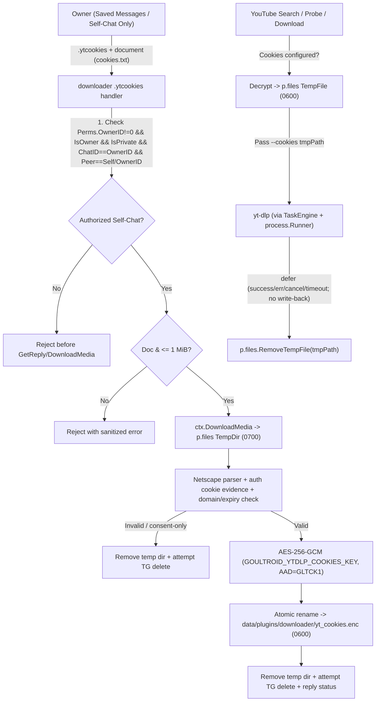

# DL-F2-A — YouTube Cookies Management: Source Audit & Detailed Design

## Status

- **Phase:** DL-F2-A (Source Audit & Detailed Design — Final Review Corrections Applied)
- **Baseline HEAD:** `5c7e328598eee3f3c4a25957f544f047fea643ec` (`test-next`)
- **Parent Plan:** `docs/design/goultroid-dl-f2-youtube-cookies-management-plan.md`
- **Production Code Changes:** None (documentation-only phase)

---

## 1. Source Audit Findings

### 1.1 Downloader Module & Capability Gate (`plugins/downloader/module.go`, `downloader.go`)

- `ModuleType.Register` constructs `Plugin` with `rt.DownloadRegistry`, `rt.Storage`, `mediaregistry.New(rt.DB)`, `rt.SettingsService`, and `rt.Logger`.
- `InitPlugin(pctx)` binds `p.files` (`*filesystem.Scope`) and `p.tasks` (`tasks.Client`).
- Current `Manifest().Capabilities` declares:
  - `CapHTTP`, `CapFilesystemTemp`, `CapFilesystemData`, `CapProcessExecute`, `CapTelegramRead`, `CapTelegramSendMessage`, `CapTasks`.
- **Gap for DL-F2-B:** `plugin.CapTelegramDeleteMessage` is **not** currently declared in `downloader`'s manifest. It must be added to `ModuleType.Manifest().Capabilities` before calling `DeleteMessage` / `ctx.Delete()`.

### 1.2 Command Authorization, `PrivateOnly` Bypass & Saved Messages Peer Verification (`internal/core/middleware.go`, `permissions.go`, `context.go`)

- **Critical security finding 1 (`PrivateOnly` bypass):** `FilterMiddleware` (`internal/core/middleware.go:224`) explicitly documents and implements:
  > `For outgoing messages (userbot owner commands), GroupOnly and PrivateOnly are bypassed`
  Therefore, setting `Permission: core.PermissionOwner` and `PrivateOnly: true` on a `core.Command` is **not sufficient** to prevent an outgoing command in a group, supergroup, or channel.
- **Critical security finding 2 (`IsOwner() && IsPrivate()` is STILL insufficient):**
  `ctx.IsPrivate()` only checks `ctx.Chat != nil && ctx.Chat.Type == "private"`. It does **not** verify that the private chat is Saved Messages / self-chat with the owner's own account. An owner running an outgoing `.ytcookies` command in a 1-on-1 private chat with another Telegram user would pass both `ctx.IsOwner()` and `ctx.IsPrivate()`, exposing `cookies.txt` in another user's chat.
- **Required mitigation (Self-chat / Saved Messages numeric peer gate):**
  Implement a single strict helper (`isAuthorizedCookieSelfChat(ctx)`) executed at the very top of `.ytcookies` upload via caption, upload via reply, `status`, and `delete` — **before** calling `GetReply()`, inspecting media metadata, or calling `ctx.DownloadMedia()`:
  1. Require `ctx.Perms != nil && ctx.Perms.OwnerID != 0`.
  2. Require `ctx.IsOwner()` and `ctx.IsPrivate()`.
  3. Require numeric peer match: `ctx.ChatID() == ctx.Perms.OwnerID`.
  4. Require `ctx.PeerID != nil` and accept only `*tg.InputPeerSelf` or `*tg.InputPeerUser` with `UserID == ctx.Perms.OwnerID`; reject any other `*tg.InputPeerUser`, `*tg.InputPeerChat`, or `*tg.InputPeerChannel`.
  5. **Note on `ctx.Self`:** `prepareCommandContext()` (`internal/telegram/dispatcher_dispatch.go`) populates `Perms`, `Chat`, `Sender`, and `PeerID`, but does **not** populate `ctx.Self`. Do **not** rely on an optional `ctx.Self.ID` check as an authorization layer; numeric `ctx.ChatID()` and `ctx.PeerID` are the authoritative boundary.
  6. **Reply-based upload sender verification (after self-chat gate passes and `GetReply()` returns `replied`):**
     - `normalizeReplyMessage()` (`internal/core/context.go`) populates `SenderID` from `FromID` only when `*tg.PeerUser`; outgoing userbot messages in Saved Messages can have `IsOutgoing == true` and `SenderID == 0`.
     - If `replied.IsOutgoing` is `true`, allow the reply (since the peer has already passed numeric Saved Messages verification and the reply is proven outgoing).
     - Otherwise (incoming message), require `replied.SenderID != 0 && replied.SenderID == ctx.Perms.OwnerID`.
     - Never treat `SenderID == 0` without `IsOutgoing == true` as proof of ownership.
  7. Never infer ownership or self-chat identity from username, display name, or filename.

### 1.3 Telegram Document Download & Size Limits (`internal/core/context_media.go`)

- `ctx.DownloadMedia(destDir)` supports both `c.Message.Media` (document with command caption) and `c.GetReply()` (command replying to a document).
- `ctx.DownloadMedia` enforces `DefaultMaxDownloadSize` (500 MB) and sanitizes filenames via `SanitizeFileName`, creating `destDir` with `0700`.
- **Required mitigation:** Because 500 MB is far too large for a `cookies.txt` file, the handler MUST inspect `media.Type == "document"` and `media.Size <= MaxCookieFileBytes` (1 MiB) **before** calling `ctx.DownloadMedia`, and verify `os.Stat` size after download.
- **Staging path:** Use a unique per-upload temp directory under `p.files.CreateTempDir("ytcookies-ingest-*")` and remove it unconditionally via `defer p.files.RemoveTempDir(tmpDir)`.

### 1.4 Telegram Message Deletion (`internal/telegram/service.go`, `internal/core/context_messages.go`)

- `TelegramServicer.DeleteMessage(ctx, peer, msgIDs)` in private chats calls `s.sender.To(currentPeer).Revoke().Messages(opCtx, msgIDs...)`.
- `ctx.Delete()` only deletes `c.Message.ID` (the command message). If the owner uploads a document first and replies to it with `.ytcookies`, `c.Message.ReplyToID` (the document message) would **not** be deleted by `ctx.Delete()`.
- **Required design:** Collect unique non-zero message IDs (`c.Message.ID`, and `replied.ID` when uploaded via reply) and call `ctx.Telegram.DeleteMessage(ctx.Ctx, ctx.PeerID, msgIDs)` (with a short bounded context if `ctx.Ctx` is cancelling). Treat deletion failure honestly as `accepted-but-delete-unconfirmed` (or `rejected-and-cleaned-delete-unconfirmed`).

### 1.5 Filesystem Scope, Config & Process Env Filtering (`internal/services/process/service.go`)

- `p.files` (`*filesystem.Scope`) provides:
  - `DataDir()` -> `data/plugins/downloader`
  - `TempDir()` -> `data/tmp/plugins/downloader`
  - `CreateTempFile` / `RemoveTempFile` / `CreateTempDir` / `RemoveTempDir`
- `internal/services/process/service.go` uses `isSensitiveEnvKey` (matching `KEY`, `SECRET`, `TOKEN`, `PASSWORD`, `CRED`, `AUTH`, `SESSION`, `PRIVATE`, etc.) in two distinct helpers:
  - `childEnv`: **omits/removes** sensitive variables completely from the child process environment (`cmd.Env`).
  - `SanitizeEnv`: **retains** the variable name in the returned slice and replaces its value with `[REDACTED]` for safe logging/display.
- Naming the deployment secret `GOULTROID_YTDLP_COOKIES_KEY` ensures `childEnv` strips it from `yt-dlp` child environments and `SanitizeEnv` redacts its value as `GOULTROID_YTDLP_COOKIES_KEY=[REDACTED]`.

### 1.6 `yt-dlp` Reproducibility & Cookie-Jar Behavior (`Dockerfile`, `provider_extractor*.go`)

- **Reproducibility gap in `Dockerfile`:** `Dockerfile:19` currently downloads `https://github.com/yt-dlp/yt-dlp/releases/latest/download/yt-dlp` (unpinned `latest`). The `yt-dlp 2026.11.23` version observed during this audit was the local host binary, which is not guaranteed to match an unpinned container build.
- **Reproducibility strategy:**
  1. Pin `yt-dlp` in `Dockerfile` to an explicit release tag (e.g. `2026.11.23` or the target release tag with SHA-256 verification) so local, CI, and production deployments run the exact same binary.
  2. Verify `--cookies` behavior against the pinned deployment version before DL-F2-D closure.
- **Verified `yt-dlp --help` behavior for `--cookies`:**
  ```
  --cookies FILE   Netscape formatted file to read cookies from
                   and dump cookie jar in
  ```
  `yt-dlp` reads cookies from `FILE` and **dumps/mutates the cookie jar back into `FILE`**. Sharing one decrypted file across concurrent `yt-dlp` processes would cause concurrent file corruption/races.

---

## 2. Explicit Design Decisions

### 2.1 Upload Trigger & Management Commands

- **Command:** `.ytcookies` (`Permission: core.PermissionOwner`, `PrivateOnly: true` + explicit `isAuthorizedCookieSelfChat(ctx)` check).
- **Subcommands:**
  - `.ytcookies` or `.ytcookies set` (as caption on a document, or replying to a document in Saved Messages) — ingests, validates, encrypts, atomically replaces active cookies, cleans plaintext temp files, and attempts to delete the uploaded Telegram message(s).
  - `.ytcookies status` — reports safe local health state (`not configured`, `configured and decryptable`, `configured but key missing/invalid`, `configured but corrupt/unreadable`) without exposing any key, path, cookie name/value, or session fingerprint.
  - `.ytcookies delete` — deletes the active encrypted credential file (and returns confirmation).
- **No ambient/passive document handler:** Arbitrary documents sent in private chat are never intercepted as cookies.

### 2.2 Storage Location, Secret Name & Encryption Envelope

- **Encrypted store path:** `<p.files.DataDir()>/yt_cookies.enc` (`data/plugins/downloader/yt_cookies.enc`), directory permissions `0700` (enforced when creating/writing), file permissions `0600`.
- **Deployment secret env var:** `GOULTROID_YTDLP_COOKIES_KEY`
  - Encoding: 32-byte raw key encoded as standard/URL base64 (44 chars) or hex (64 chars).
  - Fail-closed: if absent or malformed, `Encrypt`/`Decrypt` return an explicit configuration error (`ErrCookieKeyMissing` / `ErrCookieKeyInvalid`). Existing `yt_cookies.enc` is never overwritten or deleted on key errors.
  - Generic Downloader (`.dl`, `.download`, non-YouTube extractor, and YouTube without cookies) continues to work normally when `GOULTROID_YTDLP_COOKIES_KEY` is unset.
- **Cipher Envelope (`v1`):**
  - Authenticated encryption: **AES-256-GCM** (`crypto/aes` + `crypto/cipher.NewGCM`).
  - Versioned header: 6-byte magic `GLTCK1` bound as **AAD** (Additional Authenticated Data).
  - Nonce: fresh 12-byte cryptographic random nonce (`crypto/rand.Read`) per encryption.
  - Binary layout: `[6B "GLTCK1"][12B nonce][ciphertext + 16B GCM tag]`.
  - Atomic replacement: write to `yt_cookies.enc.tmp.<rand>` (`0600`) in `DataDir()`, `Sync()`, `Close()`, `os.Rename` to `yt_cookies.enc` (and `os.Remove` temp on any error).

### 2.3 File Limits & Cookie Authentication Validation Policy

- **Hard limits:**
  - `MaxCookieFileBytes`: `1 << 20` (1 MiB)
  - `MaxCookieLines`: `10000`
  - `MaxCookieLineBytes`: `16384` (16 KiB)
  - `CookieDownloadTimeout`: `30 * time.Second`
- **Netscape HTTP Cookie File syntax:**
  - Reject empty files, binary/NUL bytes, or non-Netscape formats (e.g. JSON, HTML).
  - Accept standard `# Netscape HTTP Cookie File` / `# HTTP Cookie File` header, comment lines (`#`), and blank lines.
  - Normalize `#HttpOnly_<domain>` prefix to `<domain>` (preserving `httpOnly` flag internally) while rejecting other malformed `#` directives that look like broken records.
  - Non-comment records MUST have exactly 7 tab-separated fields: `domain`, `includeSubdomains` (`TRUE`/`FALSE`), `path`, `secure` (`TRUE`/`FALSE`), `expiration` (non-negative integer), `name` (non-empty), `value`.
- **Domain matching & scoping:**
  - Lowercase and trim leading `.` for host comparison while enforcing consistency between leading `.` and `includeSubdomains` (`TRUE` for domain cookies `.domain`, `FALSE` for host-only cookies `domain`).
  - **Domain cookies** (e.g. `.youtube.com` / `.google.com` with `TRUE`) cover their apex and subdomains via exact label-boundary matching.
  - **Host-only cookies** (with `FALSE`) match **only** their exact host (no suffix matching): e.g. host-only `youtube.com` or `www.youtube.com` is accepted, whereas host-only `m.youtube.com` does not cover `www.youtube.com`/`youtube.com` and host-only `accounts.google.com` is not automatically treated as YouTube auth. Lookalike domains (`evil-youtube.com`, `google.com.evil.org`) MUST be rejected.
- **Expiry check:**
  - `expiration == 0` (session cookie) or `expiration > now.Unix()` is non-expired. Records with `expiration > 0 && expiration <= now.Unix()` are treated as expired and do not count as usable evidence.
- **Authentication evidence (distinguishing auth from preference/consent cookies & `(cookie-name, domain)` pairing):**
  - Preference, consent, and telemetry cookies (e.g. `CONSENT`, `SOCS`, `PREF`, `VISITOR_INFO1_LIVE`, `YSC`, `GPS`) are **not** authentication evidence. A file containing only those cookies on `.youtube.com` / `.google.com` MUST be rejected.
  - Require at least one non-expired, non-empty-value record whose `(cookie-name, domain)` pair matches a valid YouTube/Google authentication combination (not two separate independent allowlists — e.g. `SID` on `youtu.be` MUST be rejected):
    - Google/YouTube shared auth cookies (`SID`, `HSID`, `SSID`, `APISID`, `SAPISID`, `__Secure-1PSID`, `__Secure-3PSID`, `__Secure-1PAPISID`, `__Secure-3PAPISID`, `__Secure-1PSIDTS`, `__Secure-3PSIDTS`, `__Secure-1PSIDCC`, `__Secure-3PSIDCC`) on `youtube.com` (`.youtube.com`, `m.youtube.com`, `music.youtube.com`) or `google.com` (`.google.com`, `accounts.google.com`).
    - `LOGIN_INFO` on `youtube.com` (`.youtube.com`, `m.youtube.com`, `music.youtube.com`).
  - **Honest user-facing guarantee:** Local validation confirms only Netscape syntax and the presence of non-expired authentication-like cookies; it **does not guarantee** that YouTube/Google will accept the session or will not issue bot/verification challenges. Never log or echo offending lines, cookie names, or cookie values in parser errors.

### 2.4 Concurrency & Write-Back Strategy

- **Chosen strategy:** **Independent per-operation ephemeral plaintext snapshot (`0600`), no write-back.**
- **Rationale:**
  1. `yt-dlp --cookies FILE` mutates/dumps the cookie jar back to `FILE`.
  2. Creating a unique `0600` temp file per `Search`, `Probe`, or `Download` invocation via `p.files.CreateTempFile("ytdlp-ck-*")` (and removing it in `defer`) eliminates concurrent file corruption/races without introducing a global lock or starving TaskEngine's `process` pool.
  3. **No write-back to master:** `yt_cookies.enc` is never updated by `yt-dlp` execution. Any session/cookie updates written by `yt-dlp` to the ephemeral temp file are discarded when the operation finishes. If YouTube rotates or invalidates the session over time, the owner must re-upload a fresh `cookies.txt`.

### 2.5 Integration Boundary (`internal/services/download` vs `plugins/downloader`)

- `internal/services/download` remains generic and Telegram/crypto-unaware:
  - Add `CookiesFile string` to `SearchOptions`, `ProbeOptions`, and `DownloadOptions` (internal service options only; never logged or stored in `interactiveState` JSON).
  - `ExtractorProvider.Search`, `Probe`, and `Download` append `"--cookies", opts.CookiesFile` to `yt-dlp` `Args` only when `opts.CookiesFile != ""`.
- `plugins/downloader` owns the YouTube cookie policy:
  - Only YouTube operations (`.yt` search, and `.dl`/`.yt`/a2 when URL is YouTube) request an ephemeral decrypted cookie file from the plugin's cookie store.
  - Non-YouTube extractor and DirectHTTP operations never receive `CookiesFile` and never depend on `GOULTROID_YTDLP_COOKIES_KEY`.
  - If cookies are configured but cannot be decrypted (missing/wrong key or corrupt file), YouTube operations fail closed with a sanitized configuration/storage error rather than silently downgrading.

---

## 3. Data-Flow & Threat Model

### 3.1 Data-Flow Diagram



### 3.2 Threat Model

| Threat | Vector | Mitigation |
|---|---|---|
| Outgoing command in wrong private chat | `FilterMiddleware` bypasses `PrivateOnly` for outgoing owner commands; `IsPrivate()` allows 1-on-1 chats with other users; `ctx.Self` is not set by `prepareCommandContext()` | Explicit `isAuthorizedCookieSelfChat(ctx)` verifying `ctx.Perms.OwnerID != 0`, `IsOwner()`, `IsPrivate()`, `ChatID == OwnerID`, and `PeerID` is `InputPeerSelf` or `InputPeerUser(OwnerID)` before `GetReply()` / media access / `DownloadMedia()`; for replies, require `replied.IsOutgoing` or `replied.SenderID == OwnerID` (never `SenderID == 0` without `IsOutgoing`) |
| Consent/preference-only file accepted as auth | `CONSENT`, `SOCS`, `PREF`, `VISITOR_INFO1_LIVE` on `.youtube.com` / `.google.com` | Require non-expired, non-empty recognized Google/YouTube auth cookie (`SID`, `__Secure-1PSID`, `__Secure-3PSID`, `HSID`, `SSID`, `APISID`, `SAPISID`, `LOGIN_INFO`, etc.) on exact label-matched domain |
| DoS via huge/malformed upload | 500 MB Telegram document or huge lines | Pre-download `media.Size <= 1 MiB` check, line count/length caps, bounded timeout |
| Path traversal / filename injection | Malicious document filename (`../../etc/passwd`) | Ignore user filename for persistence; use `CreateTempDir` + fixed `yt_cookies.enc` path |
| Plaintext credential leakage at rest | Unencrypted file on disk or leftover temp file | AES-256-GCM at rest (`0600`), `defer` cleanup on all paths, startup/shutdown temp sweep |
| Key leakage to child processes or logs | `yt-dlp` inheriting `os.Environ()` or env logs | `GOULTROID_YTDLP_COOKIES_KEY` omitted by `process.childEnv` and redacted as `[REDACTED]` by `process.SanitizeEnv` |
| Secret leakage in Telegram/logs | Parser error echoing line, `yt-dlp` stderr/args logged | Sanitized parser errors; never log cookie contents/names/values; `--cookies` passes path only |
| Concurrent `yt-dlp` cookie-jar corruption | Parallel `Probe`/`Search`/`Download` writing to same file | Per-operation ephemeral `0600` temp snapshot, removed on exit, no write-back |
| Failed replacement breaks working cookies | Corrupt upload or key error overwrites `yt_cookies.enc` | Validate + encrypt to temp file first; atomic `os.Rename` only after full success |

---

## 4. Verification Plan for Implementation Phases

- **DL-F2-B:** Owner/non-owner, private/non-private, **outgoing owner command in another user's private DM rejected before `GetReply()` / media access / `DownloadMedia()`**, **Saved Messages with outgoing document (`IsOutgoing == true`, `SenderID == 0`) replied to by owner command accepted**, **reply to incoming message from owner accepted only when `SenderID == ctx.Perms.OwnerID`**, **reply to message from another user rejected**, **`SenderID == 0` without `IsOutgoing == true` rejected**, document type/size pre-check, Netscape parser unit tests (including **active `CONSENT`/`SOCS`/`PREF`-only cookies rejected**, lookalike domains rejected, host-only vs `.domain`, `#HttpOnly_`, expired auth cookies rejected), temp cleanup, Telegram deletion success & unconfirmed warning.
- **DL-F2-C:** AES-256-GCM encrypt/decrypt, AAD mismatch, wrong/missing key fail-closed, tamper/truncation, atomic replace preserving prior valid file, `0600` permissions, delete.
- **DL-F2-D:** Pinned `yt-dlp` version verification, `--cookies` arg passed to `Search`, `Probe`, `Download` for YouTube only; non-YouTube & DirectHTTP unaffected; absent cookies fallback; concurrent `Probe`/`Download` temp isolation; no write-back to master; `defer` cleanup on error/cancel/timeout.
- **DL-F2-E:** `.ytcookies status` / `delete` EN+ID localization, secret-leakage audit across logs/errors/user messages, `gofmt`, `go vet`, `go test -count=1 -race`, `internal/architecture`, `go build ./cmd/goultroid`.
